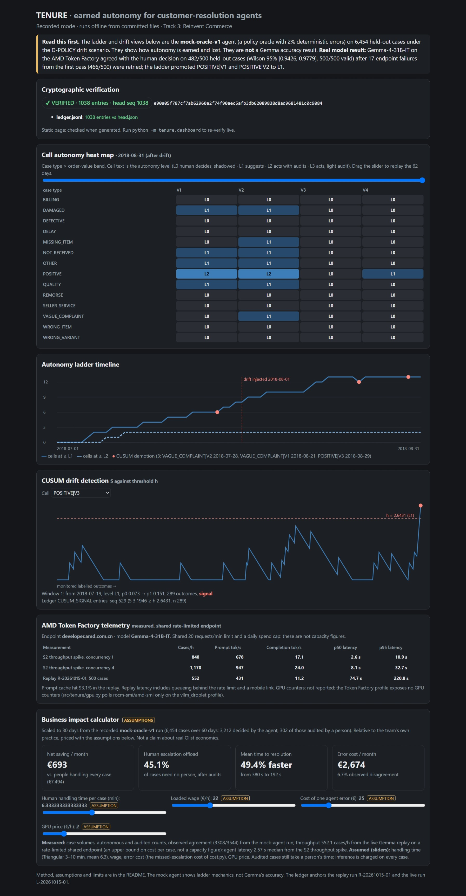

# TENURE

Earned autonomy for customer-resolution agents powered by Gemma-4-31B-IT on the AMD Token Factory.

[](https://suryaprasanthcse.github.io/amd-tenure/)

Live dashboard (click the preview): https://suryaprasanthcse.github.io/amd-tenure/

TENURE lets an AI refund agent earn autonomy one cell (case type × order-value band) at a time. A cell is promoted only when statistics show the agent is as consistent as the human team. The agent demotes itself when it drifts, and every decision is recorded in a hash-chained ledger. The design is in [`TENURE_master_blueprint.md`](TENURE_master_blueprint.md) and the build plan is in [`RUNBOOK_TENURE.md`](RUNBOOK_TENURE.md).

> Status: under construction for the AMD Developer Hackathon: ACT III (lablab.ai). Later sections are filled in from measured results as the build progresses.

## What is measured, what is simulated, what is assumed

| Layer | What it is | Figures | Status |
|---|---|---|---|
| **Real model evaluation** | Gemma-4-31B-IT on the AMD Token Factory (`developer.amd.com.cn`), replayed over held-out Olist cases against the human decision | 500 held-out cases · 482 agreements (96.4%) · Wilson 95% CI [0.943, 0.978] · 500/500 valid. The first pass (`R-20261015-01`) had 466/500 (93.2%) with 17 endpoint failures (3.4%, mobile link), counted as disagreements; the 17 were retried (`R-20261016-01`, same model and prompt, 483 completions reused from the cache) | Measured. The ladder, gates unchanged, promoted POSITIVE\|V1 and POSITIVE\|V2 to L1 (n 139 and 130). Nothing reaches L2 (N_MIN, DWELL) |
| **Longitudinal drift replay** | 6,454 synthetic-human cases over 60 days with an injected policy change, run with the `mock-oracle-v1` agent (a policy oracle with 2% deterministic errors), not Gemma | Cells promote L0 → L1 → L2, and CUSUM demotes 3 cells automatically (S above h) | Simulated. Shows the ladder mechanics, not model accuracy |
| **Business assumptions** | The replay's volumes priced with labelled, adjustable assumptions (D-assume) | Human-only handling cost €7,494 per month · net saving €693 per month · 45.1% of cases need no person after audits | Assumed. The team's own practice priced with assumptions, not real merchant economics |

AMD usage: the decider calls the AMD Token Factory (an OpenAI-compatible endpoint serving Gemma-4-31B-IT). No ROCm
profiling or GPU telemetry is claimed or included.

## Quickstart (offline, no API key)

Python 3.12+ and [uv](https://docs.astral.sh/uv/). Nothing below calls the network.

```bash
uv sync
uv run python -m tenure.dashboard            # recorded dashboard at http://127.0.0.1:8765
uv run python -m tenure.dashboard verify     # re-verify the SHA-256 ledger chain against head.json
uv run python -m tenure.dashboard --site docs   # GitHub Pages site: docs/index.html (+ docs/dashboard.html redirect), no server
uv run python -m tenure.dashboard --out page.html   # or one self-contained page at any path
TENURE_LLM_API_KEY=mock_key TENURE_LLM_BASE_URL=http://127.0.0.1:9/v1 uv run pytest   # offline suite (mock endpoint)
```

The test suite runs against an in-process mock endpoint (D-offline-gates), so the keys above are placeholders.
It takes a few minutes. The tests that call the real Token Factory endpoint are not part of this offline run.

### What the dashboard shows

| Panel | Source |
|---|---|
| Verification badge | recomputes the hash chain of `exports/R-20261016-01/ledger.jsonl` against `head.json` (seq 1038; the earlier export `exports/R-20261015-01/`, head seq 532, is its prefix); a local `var/ledger.db`, if present, is checked too |
| Cell heat map and ladder timeline | `exports/L-20261015-01/dashboard_data.json`, the recorded live D-POLICY run |
| CUSUM curves (S against h) | the same fixture; the re-run monitors reproduce the 3 `CUSUM_SIGNAL` entries in the ledger exactly |
| Business impact | the fixture's run volumes, scaled to 30 days, priced with labelled, adjustable assumptions (D-assume) |

**Read this before quoting a number.** The ladder, drift and impact views come from the `mock-oracle-v1` agent (a policy
oracle with 2% deterministic errors), because the gates ran offline under D-offline-gates. They show how autonomy is
earned and lost, not how accurate Gemma is. On Gemma-4-31B-IT, the real 500-case replay agrees with the human
decision on 482/500 cases (Wilson 95% [0.943, 0.978]) once 17 endpoint failures were retried, and POSITIVE|V1 and POSITIVE|V2 reached L1 on that evidence. The business
panel is the team's own practice priced with assumptions, not real merchant economics.

Regenerating the fixture needs the local run data (`var/runs/`, not committed): `uv run python -m tenure.dashboard build`.

Submission: AMD Developer Hackathon: ACT III, **Track 3: Reinvent Commerce**. Feature freeze and submission target
18 Oct 2026, 12:00 IST (the lablab deadline is 15:30 IST).

## AI & Human Collaboration Disclosure

This project is built by a human developer working with an AI coding assistant. We disclose this in line with the hackathon's transparency rules.

| Item | Detail |
|---|---|
| Human author | Surya Prasanth R: sole author and committer of this repository |
| AI assistant | Claude Code, running Anthropic Claude models (Claude Opus) |
| What the AI did | Helped draft the master blueprint and the build runbook; generates code, tests and documentation module by module (T00–T08) under a test-first contract |
| What the human did | Chose the problem and product direction; owns the refund policy (`policy/refund_rules_v1.md`); makes every recorded decision in `.agent/DECISIONS.md`; reviews, runs and accepts each module's gate; labels the 300-case gold set; records the video and submits |
| Verification | Every module must pass an automated gate (`scripts/gate.py`) before it is accepted. Numbers in the README, slides and video come from run manifests and the ledger, never typed by hand |
| Session log | `.agent/DEVLOG.md` records each AI-assisted session: module, model, times and gate result |

The application uses Google's Gemma models, served on AMD Instinct GPUs, as its decision agent at runtime. That use is a feature of the product and is separate from the development assistance described above.
