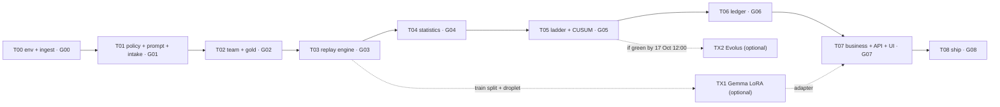

# RUNBOOK · TENURE build pipeline
### Compiles `TENURE_master_blueprint.md` into 9 gate-enforced modules (T00–T08) plus 2 optional lanes

| Field | Value |
|---|---|
| Spec | `TENURE_master_blueprint.md`, cited as **master §n**. Appendix R holds verified reference code; Appendix T holds golden tests |
| Rules | `policy/refund_rules_v1.md`, cited as **Policy §n**. Human-owned |
| Target agent | Claude Opus 5.5 (`claude-opus-5-5`) in Claude Code, high effort. **One fresh session per module** |
| Harness | uv + pytest + pytest-cov + hypothesis; `scripts/gate.py` (cumulative gates, verified in §3.4) |
| Budget | **42 human hours** on the critical path (T00–T08). Optional lanes: TX1 (LoRA, ~3 h human + GPU wall time) and TX2 (Evolus, 6–8 h) |
| Deadline | lablab.ai submission closes **18 Oct 2026, 15:30 IST** (checked on the event page 2026-10-16; the earlier 20:30 was wrong). Feature freeze and submission target: **12:00 IST** (D-deadline). Track 3: Reinvent Commerce |
| Driver | Manual: paste one module block per session. ORRERY-Lite's parser is specific to RUNBOOK_A (module IDs `A\d{2}`), so it cannot drive this file without a parser patch, which is not worth building in this window |

---

## 0. How to run

1. **Before T00 (human, about 30 min)**:
   - join the AMD AI Developer Program and create an AMD Token Factory API key;
   - create a Kaggle API token;
   - on Hugging Face, accept the Gemma licence (needed only for the droplet profile);
   - write `.env` from `.env.example`.

   None of these steps can be delegated: they involve your accounts and credentials.
2. Open a fresh Claude Code session at `C:/myspace/hacckathons/amd-tenure/` and paste **T00** verbatim. Let it reach its exit gate.
3. For each later module, in order (§5):
   1. start a **new** session;
   2. paste the block;
   3. answer any `DECISIONS` it raises;
   4. confirm the gate is green;
   5. continue.
4. When a module stops on a question, answer it in `.agent/STATE.md` → `open_questions`, then re-paste the same block into a new session. Blocks are idempotent: they resume from `STATE.md`.
5. Do not continue a module in a session that has compacted its context. Re-paste it into a fresh session instead.
6. Long jobs run in the background while the next module proceeds, and their outputs are picked up later: intake over all cases (T01), the full replay (T03), and LoRA training (TX1).

## 1. Calendar (IST) and budget

| Module | Content | Budget | Target window |
|---|---|---|---|
| T00 | Environment, Olist ingestion, Token Factory client, S1 | 4.0 h | 14 Oct 21:00 – 15 Oct 01:00 |
| T01 | Policy, prompt with prefix caching, JSON parsing, intake, S2/S3 | 4.0 h | 15 Oct 09:00 – 13:00 |
| T02 | Synthetic team, gold-set harness | 3.5 h | 15 Oct 13:30 – 17:00 |
| T03 | Async replay engine, outcome cache, shadow matrix, events | 5.5 h | 15 Oct 17:30 – 23:00 (full replay runs overnight) |
| T04 | Wilson-cc, non-inferiority, baselines, cost-weighted error | 3.0 h | 16 Oct 09:00 – 12:00 |
| T05 | Ladder state machine, CUSUM, live routing, drift | 4.5 h | 16 Oct 12:30 – 17:00 (TX1 starts in parallel) |
| T06 | Hash-chained ledger, verify, export, governance report | 2.5 h | 16 Oct 17:30 – 20:00 |
| T07 | Business engine, API with SSE, dashboard, recorded bundle | 9.0 h | 16 Oct 20:30 – 23:30, then 17 Oct 09:00 – 15:00 |
| Human | Label the 300 gold cases | 2.5 h | 17 Oct 15:30 – 18:00 |
| T08 | Deployment, public URL, README, video script, slides, submission | 6.0 h | 17 Oct 19:00 – 22:00, then 18 Oct 09:00 – 12:00 |
| Human | Feature freeze 12:00; record the video; slides PDF; submit | 3.0 h | 17 Oct evening, submit by 18 Oct 12:00 IST (hard stop 15:30) |
| **Total** | | **≈ 48.5 h** (42 h of modules + 6.5 h of human tasks) | |

## 2. Agent operating contract (T00 saves this verbatim as `.agent/CONTRACT.md`)

```text
TENURE AGENT OPERATING CONTRACT (applies to every module)

C1  SOURCE OF TRUTH. TENURE_master_blueprint.md defines behaviour; policy/refund_rules_v1.md defines
    the refund rules. Appendix R modules are NORMATIVE: port them verbatim into src/tenure/. Any change
    to an Appendix R module needs a DECISIONS entry (id, reason, approver) before it is made.
C2  READ BUDGET. Read .agent/CONTRACT.md, .agent/STATE.md, your module block, and only the master
    sections listed under INPUTS. Follow a cross-reference only to that section.
C3  TESTS FIRST. For each batch: (a) write the tests; (b) run them and confirm they FAIL for the
    right reason (missing in-scope module or attribute, or an assertion), not a harness error;
    (c) save the output to .agent/evidence/<module>/red-<n>.txt; (d) commit "test(<module>): <batch>";
    (e) implement; (f) run until green and save green-<n>.txt; (g) commit "feat(<module>): <batch>".
C4  NEVER WEAKEN TESTS. Do not delete, skip, xfail, loosen or rename a test. If a test is wrong, stop
    and add an open question to STATE.md.
C5  SCOPE. Create or modify only the files in your module's SCOPE, tests, and .agent/*.
C6  NO PLACEHOLDERS. No TODO, FIXME, NotImplementedError or pass-only bodies in src/.
C7  DETERMINISM. Seeds come from tenure.yaml. Clocks are injected. Iterate in sorted order wherever
    output is hashed or recorded.
C8  SECRETS. Read keys only from environment variables. Never print, log or write them anywhere except
    .env. Never commit .env, data/raw, data/derived or var/.
C9  MEASURED, NOT CLAIMED. Every number meant for the README, slides or video must come from a run
    manifest, the ledger or a spike record. Never type such a number by hand.
C10 HANDOFF. Before ending: update STATE.md, run scripts/gate.py <G> (writes gates/<G>.json), append
    one line to DEVLOG.md (module, model, start/end time, gate result, measured numbers), and commit
    "gate(<G>): green".
C11 STOP. Stop and record an open question on: a spec ambiguity that changes behaviour; a failed
    precondition; a spike result that contradicts the spec; any need to edit an existing test; or
    context near exhaustion (record the exact resume point in STATE.md).
```

## 3. Harness

### 3.1 `pyproject.toml` (created in T00)

```toml
[project]
name = "tenure"
version = "0.1.0"
description = "Earned autonomy for customer-resolution agents on AMD Instinct and Gemma"
readme = "README.md"
requires-python = ">=3.12,<3.13"
license = { text = "MIT" }
dependencies = [
  "numpy>=2.0", "pandas>=2.2", "pyarrow>=16", "pydantic>=2.7", "pyyaml>=6.0", "httpx>=0.27",
  "fastapi>=0.111", "uvicorn[standard]>=0.30", "sse-starlette>=2.1", "typer>=0.12", "rich>=13",
]

[project.optional-dependencies]
# Install on the ROCm droplet only, with torch taken from the ROCm wheel index or the droplet image.
finetune = ["transformers>=4.44", "peft>=0.12", "trl>=0.9", "datasets>=2.20", "accelerate>=0.33"]

[dependency-groups]
dev = ["pytest>=8", "pytest-cov>=5", "pytest-asyncio>=0.23", "hypothesis>=6.100", "ruff>=0.5"]

[project.scripts]
tenure = "tenure.cli:app"

[build-system]
requires = ["hatchling"]
build-backend = "hatchling.build"

[tool.hatch.build.targets.wheel]
packages = ["src/tenure"]

[tool.pytest.ini_options]
testpaths = ["tests"]
addopts = "--strict-markers -q"
asyncio_mode = "auto"
markers = [
  "unit: pure functions", "integration: stores, ingestion, fake LLM, API",
  "llm: needs a live endpoint (TENURE_LLM_*)", "data: needs Olist files in data/raw",
  "e2e: recorded bundle and web build",
  "gate_g00: T00", "gate_g01: T01", "gate_g02: T02", "gate_g03: T03", "gate_g04: T04",
  "gate_g05: T05", "gate_g06: T06", "gate_g07: T07", "gate_g08: T08",
]

[tool.ruff]
line-length = 120
target-version = "py312"
```

### 3.2 Markers

Every test module declares `pytestmark = [pytest.mark.<kind>, pytest.mark.gate_gNN]`.

- A gate runs its own marker **and every earlier one**. That makes it a regression ratchet.
- `llm` and `data` tests are part of the gates. Run gates locally with `.env` loaded and `data/raw` present. **A missing endpoint or missing data fails the gate; it never skips.**
- CI (GitHub Actions) runs `-m "not llm and not data"` on every push.

### 3.3 Hypothesis profile

`tests/conftest.py` registers a `ci` profile (`max_examples=200`, `derandomize=True`, `deadline=2000`) and loads it by default.

### 3.4 Gate runner `scripts/gate.py`

This script was verified on 14 Oct in a scratch repository. It is green on a clean module, and red on each of: a skipped test, a TODO, a pass-only body, coverage below threshold, and missing red evidence.

```python
#!/usr/bin/env python3
"""Cumulative gate runner for RUNBOOK_TENURE.  Usage: uv run python scripts/gate.py G03

A gate runs every test marked with its own gate marker or any earlier gate's marker, so each
gate is a regression ratchet. It fails on any failure, error or skip, on forbidden patterns in
src/tenure, on coverage below threshold, and on missing TDD evidence for the module.
"""
from __future__ import annotations

import datetime as dt
import json
import re
import subprocess
import sys
import xml.etree.ElementTree as ET
from pathlib import Path

ORDER = ["G00", "G01", "G02", "G03", "G04", "G05", "G06", "G07", "G08"]
STRICT = {"stats", "cost", "cusum", "ladder", "ledger", "policy", "humans", "business"}  # >= 90%
EXEMPT = {"__init__", "cli", "api", "gpu", "finetune"}  # exercised by e2e and manual runs
DEFAULT_MIN, STRICT_MIN = 0.80, 0.90
FORBIDDEN = re.compile(r"\b(TODO|FIXME|XXX)\b|NotImplementedError|pytest\.skip|\bxfail\b")
PASS_ONLY = re.compile(r"def [^\n]+:\n(?:[ \t]+(?:\"\"\"|''')[^\n]*(?:\"\"\"|''')\n)?[ \t]+pass[ \t]*\n")
ROOT = Path(__file__).resolve().parents[1]


def git(*args: str) -> str:
    try:
        return subprocess.run(["git", *args], cwd=ROOT, capture_output=True, text=True, check=True).stdout.strip()
    except (subprocess.CalledProcessError, FileNotFoundError):
        return ""


def junit_counts(path: Path) -> dict[str, int]:
    root = ET.parse(path).getroot()
    suites = [root] if root.tag == "testsuite" else list(root.iter("testsuite"))
    keys = ("tests", "failures", "errors", "skipped")
    return {k: sum(int(s.get(k, 0)) for s in suites) for k in keys}


def forbidden_hits() -> list[str]:
    hits = []
    for p in sorted((ROOT / "src" / "tenure").rglob("*.py")):
        text = p.read_text(encoding="utf-8")
        rel = p.relative_to(ROOT).as_posix()
        for m in FORBIDDEN.finditer(text):
            hits.append(f"{rel}:{text.count(chr(10), 0, m.start()) + 1}: {m.group(0)}")
        if PASS_ONLY.search(text):
            hits.append(f"{rel}: pass-only function body")
    return hits


def tdd_evidence(module: str) -> list[str]:
    problems = []
    ev = ROOT / ".agent" / "evidence" / module
    if not any(ev.glob("red-*.txt")):
        problems.append(f"no red evidence in .agent/evidence/{module}/")
    subjects = git("log", "--reverse", "--format=%s").splitlines()
    tests = [i for i, s in enumerate(subjects) if s.startswith(f"test({module})")]
    feats = [i for i, s in enumerate(subjects) if s.startswith(f"feat({module})")]
    if feats and (not tests or tests[0] > feats[0]):
        problems.append(f"feat({module}) commit precedes any test({module}) commit")
    return problems


def main(argv: list[str]) -> int:
    if len(argv) != 2 or argv[1].upper() not in ORDER:
        print(f"usage: gate.py <{'|'.join(ORDER)}>")
        return 2
    gate = argv[1].upper()
    module = "T" + gate[1:]
    markers = " or ".join(f"gate_{g.lower()}" for g in ORDER[: ORDER.index(gate) + 1])
    out = ROOT / "var" / "gates"
    out.mkdir(parents=True, exist_ok=True)
    junit, cov = out / f"{gate}.junit.xml", out / f"{gate}.cov.json"
    cmd = [sys.executable, "-m", "pytest", "-m", markers, "--strict-markers", "-p", "no:randomly",
           f"--junitxml={junit}", "--cov=tenure", f"--cov-report=json:{cov}", "--cov-report=term-missing:skip-covered"]
    rc = subprocess.call(cmd, cwd=ROOT)
    problems: list[str] = []
    counts = junit_counts(junit) if junit.exists() else {"tests": 0, "failures": 0, "errors": 0, "skipped": 0}
    if rc != 0 or counts["failures"] or counts["errors"]:
        problems.append(f"pytest rc={rc} failures={counts['failures']} errors={counts['errors']}")
    if counts["skipped"]:
        problems.append(f"{counts['skipped']} skipped (gates allow none)")
    if counts["tests"] == 0:
        problems.append("no tests selected")
    hits = forbidden_hits()
    problems += [f"forbidden: {h}" for h in hits]
    coverage: dict[str, float] = {}
    if cov.exists():
        for path, data in json.loads(cov.read_text(encoding="utf-8"))["files"].items():
            name = Path(path).stem
            pct = data["summary"]["percent_covered"] / 100.0
            coverage[name] = round(pct, 4)
            need = STRICT_MIN if name in STRICT else DEFAULT_MIN
            if name not in EXEMPT and pct < need:
                problems.append(f"coverage {name} {pct:.1%} < {need:.0%}")
    problems += tdd_evidence(module)
    status = "red" if problems else "green"
    record = {"gate": gate, "module": module, "status": status, "commit": git("rev-parse", "HEAD"),
              "utc": dt.datetime.now(dt.timezone.utc).isoformat(timespec="seconds"), "tests": counts,
              "coverage": coverage, "forbidden": len(hits), "problems": problems}
    (ROOT / "gates").mkdir(exist_ok=True)
    (ROOT / "gates" / f"{gate}.json").write_text(json.dumps(record, indent=2) + "\n", encoding="utf-8")
    print(f"\n{gate}: {status.upper()}")
    for p in problems:
        print(f"  - {p}")
    return 0 if status == "green" else 1


if __name__ == "__main__":
    sys.exit(main(sys.argv))
```

## 4. Handoff files

### 4.1 `.agent/STATE.md`

```text
# STATE
current_module:   <Txx>   status: in_progress | blocked | green
last_green_gate:  <Gxx>
platform_facts:   S1: <PASS|FAIL> → base_url host, model id, rate-limit headers
                  S2: cases/min=…, prompt_tps=…, completion_tps=…, cached_ratio=…, p95_ms=…, concurrency=…
                  S3: structured_mode=…, system_mode=…, valid_rate=…
                  S4/S5/S6: …
data_facts:       cases by split=…, band shares=…, case types=…, hh agreement=…
runs:             R-… (mode, split, run_key, ledger head)
open_questions:   <n> (listed below, each with options and the blocking flag)
resume_point:     <file / test / step>
module_table:     | module | gate | status | commit |
```

### 4.2 `.agent/DECISIONS.md` (the human owns these; the agent proposes)

| ID | Decision | Raised in | Default if not decided |
|---|---|---|---|
| D-fx | `brl_per_eur`, with its source and date | T00 | 6.00, kept labelled ASSUMPTION everywhere |
| D-band | Value-band edges if any band holds < 5% of cases | T00 | §1.2 edges |
| D-mode | Structured-output mode, system mode, concurrency (from S2/S3) | T01 | First mode with ≥ 99% valid output |
| D-gates | Per-level n_min, δ, dwell, confirm_ticks | T05 | master §4.5 |
| D-dmax | Monitoring-power limit D_max (from the sensitivity table) | T05 | 60 days |
| D-ni | NI mode: `fixed_baseline` or `strict` | T05 | `fixed_baseline` |
| D-assume | Business and cost assumptions, with sources where available | T07 | master §5.6, §8.5, labelled |
| D-drift | Drift scenario and date for the video | T05 | D-POLICY on 2018-08-01 |
| D-lora | Run TX1 or not (S4 result) | T05 | Run if S4 passes |
| D-evolus | Run TX2 or not | T05 | Only if G05 is green by 17 Oct 12:00 |

Format: `D-<id> | <date> | <module> | decision | reason | source | approved-by: <you> | status`

### 4.3 `.agent/DEVLOG.md`

One line per session: `<utc start> | <utc end> | <module> | claude-opus-5-5 | gate <G> <status> | <measured numbers>`. The README's AI-disclosure section is generated from it in T08.

## 5. Module DAG



---

## 6. Modules

Every block is self-contained. Paste the whole fenced block into a fresh session.

### T00 · Environment, Olist ingestion, Token Factory client · gate G00

```text
MODULE T00 · GATE G00 · DEPENDS: none · BUDGET 4.0 h

CAPSULE
TENURE grants an AI refund agent autonomy one cell (case type × order-value band) at a time, only
when statistics show it is as consistent as the human team; it demotes itself on drift and records
everything in a hash-chained ledger. Gemma runs on AMD Instinct GPUs (AMD Token Factory or vLLM on
ROCm). This module builds the repository skeleton, the configuration, ingestion of the real Olist
dataset into one row per customer contact, and the OpenAI-compatible client with a live smoke test.

PRECONDITIONS
- Working directory C:/myspace/hacckathons/amd-tenure contains TENURE_master_blueprint.md,
  RUNBOOK_TENURE.md, policy/refund_rules_v1.md, scripts/fetch_olist.{ps1,sh}, .gitignore.
- data/raw/ holds the 9 Olist CSVs (human ran scripts/fetch_olist.ps1, see RUNBOOK §8).
- .env has TENURE_LLM_BASE_URL, TENURE_LLM_API_KEY, TENURE_LLM_MODEL (AMD Token Factory).
- uv and git are available. If git is not initialised: git init, then first commit of the docs.
- D-fx decided in .agent/DECISIONS.md, or the human explicitly accepts 6.00 as an ASSUMPTION.

INPUTS
master §0.4, §0.5, §1.2, §10 (all), §13.1–§13.3, §13.6, §22, §23, §24 (S1), Appendix R.1, R.4, R.14,
R.15, R.16, Appendix T (test_io.py), RUNBOOK §2, §3, §4.

SCOPE (create)
pyproject.toml · tenure.yaml · .env.example · LICENSE (MIT) · README.md (title + one line)
src/tenure/{__init__,domain,canonical,olist,llm,store,config,cli}.py · scripts/gate.py (RUNBOOK §3.4)
scripts/spikes/s1_models.py · tests/conftest.py · tests/fixtures/olist_mini/build.py
tests/unit/{test_domain,test_canonical,test_config}.py · tests/integration/{test_io,test_ingest_real}.py
tests/integration/test_llm_live.py · .agent/{CONTRACT,STATE,DECISIONS,DEVLOG}.md

STEP 1 · TESTS FIRST (RED)
unit (gate_g00):
  - test_value_band_edges: 0→V1, 1499→V1, 1500→V2, 3999→V2, 4000→V3, 10000→V4; negative raises
  - test_hashes_deterministic: unit_hash in [0,1), equal inputs equal outputs, part order matters
  - test_canonical: sorted keys, UTF-8 not escaped, floats rejected, naive datetime rejected,
    Decimal normalised, nested lists and dicts
  - test_config_loads_and_hashes: tenure.yaml loads into the Pydantic model; unknown key → error;
    TENURE_LEDGER_DB env override applies; config_sha stable across loads; brl_per_eur is Decimal
integration (gate_g00):
  - Appendix T test_io.py ingestion, conversion, client and store tests (copy verbatim; the
    olist_mini writer moves to tests/fixtures/olist_mini/build.py)
data (gate_g00, marker data):
  - test_real_files_present: the 9 files exist; load_tables passes
  - test_real_cases_shape: build_cases on data/raw → ≥ 20,000 cases with text; case_id unique;
    every split train/replay/live non-empty; days_late null ⇔ not delivered; amounts ≥ 0;
    each band share ≥ 5% (on failure: STOP and raise D-band with the measured shares)
llm (gate_g00, marker llm):
  - test_models_endpoint_lists_configured_model (S1)
  - test_one_completion_nonempty: one chat completion via LLMClient returns text, error None
Run; confirm RED for the right reason; save evidence; commit.

STEP 2 · IMPLEMENT (GREEN)
- Port Appendix R.1, R.4, R.14, R.15, R.16 verbatim.
- config.py: Pydantic v2 models mirroring master §22 exactly (extra="forbid"); load(path) applies
  TENURE_* env overrides for paths and profile env names; config_sha = sha256(canonical(model_dump)).
- cli.py (typer): `tenure doctor` (python, uv lock, data files, env vars present without printing
  values, endpoint reachable), `tenure ingest` (writes data/derived/cases.parquet and
  ingest_manifest.json with counts per split and band plus sha256 of every raw file),
  `tenure smoke --n 3` (S1).
- scripts/spikes/s1_models.py: GET {base}/models and one completion; prints a STATE-ready line.
- Run `uv run tenure ingest`, then record data_facts in STATE.md.

STEP 3 · EXIT GATE
uv run python scripts/gate.py G00 → green.

STEP 4 · HANDOFF
STATE: S1 fact; data_facts (counts per split, band shares, delivered share); D-fx status.
DEVLOG line. Commit "gate(G00): green".

DEMO ARTIFACTS
ingest_manifest.json (counts quoted in the README "Data" section).

STOP CONDITIONS
S1 fails → write the open question "use droplet profile?" with the master §24 fallback; do not start
a droplet without the human. A band below 5% → raise D-band.
OUT OF SCOPE: policy, prompt, intake, any LLM decision logic.
```

### T01 · Policy, prompt with prefix caching, structured JSON, intake · gate G01

```text
MODULE T01 · GATE G01 · DEPENDS: G00 · BUDGET 4.0 h

CAPSULE
(as T00). This module makes the policy executable and the agent's input and output exact: the
policy oracle (used only by the synthetic team), the doc-code sync check, the prefix-cacheable
prompt, the decision JSON schema with parsing and normalisation, the frozen intake classification,
and spikes S2 (throughput, prefix cache) and S3 (structured-output mode).

PRECONDITIONS
gates/G00.json green. data/derived/cases.parquet exists. Endpoint reachable.

INPUTS
master §1.1, §2, §11, §12 (all), §13.2–§13.5, §24 (S2, S3), Appendix A, R.3, R.5, R.11,
Appendix T (policy, parse, prompt tests). Policy §0–§5.

SCOPE
src/tenure/{policy,schema,prompt,intake}.py · src/tenure/cli.py (intake, decide-sample, spike)
policy/refund_rules_v2.md (copy of v1 with P1 = flat EUR 5.00 for 1–5 days late) · policy/examples_v1.jsonl
policy/digest_v1.md (clause tables only, for TX1) · scripts/spikes/{s2_throughput,s3_structured}.py
tests/unit/{test_policy,test_policy_doc_sync,test_schema,test_prompt,test_intake}.py
tests/integration/test_decide_live.py · tests/fixtures/llm/ (recorded completions)

STEP 1 · TESTS FIRST (RED)
unit (gate_g01):
  - Appendix T: test_policy_total_and_well_formed, test_policy_total_when_status_and_dates_disagree,
    test_policy_specific_rules, test_parse_and_agree, test_prompt_static_prefix_is_shared
  - test_doc_sync_clauses: the clause IDs parsed from the policy markdown tables == policy.CLAUSES
  - test_doc_sync_thresholds: "500.00", "more than 5", "1 to 5", "20%", "10%", "5%", "30 days" present
  - test_examples_consistent: every policy/examples_v1.jsonl answer equals the oracle on its case
  - test_v2_differs_only_in_p1: the oracle under POLICY_V2 differs from V1 only on clause P1 cases
  - test_static_block_has_no_case_data: no case_id, date or amount pattern in static_block();
    prompt_sha is stable across processes
  - test_case_block_field_order and eur() formatting (0 → "0.00", 5 → "0.05", 123456 → "1234.56")
  - test_intake_keywords: one Portuguese message per rule, in master §11 order; score rules
  - test_intake_freeze: re-running intake never changes an existing (case_id → case_type); new cases only
llm (gate_g01):
  - test_s3_valid_rate: 100 replay cases in the chosen structured_mode → valid ≥ 99%
  - test_intake_live_sample: 50 cases → every label in the 14 types
Run; RED; evidence; commit.

STEP 2 · IMPLEMENT (GREEN)
- Port R.3, R.5, R.11 verbatim.
- intake.py: Gemma classification (master §11 prompt; schema {"case_type": enum}) through the
  ReplayEngine-free simple async loop (asyncio.gather with a Semaphore); keyword fallback;
  writes data/derived/intake.parquet (case_id, case_type, source, intake_model, intake_prompt_sha)
  and merges into cases.parquet. Idempotent and resumable.
- s3_structured.py: tries the modes in master §13.2 order and both system modes; writes the first
  mode with ≥ 99% valid output to tenure.yaml (profile) and STATE.
- s2_throughput.py: 500 replay cases at concurrency 16/32/64/128; prints cases/min, prompt and
  completion tokens/s, cached ratio (from usage, else first-call vs later latency), p50/p95, errors.
- Record ~30 completions as fixtures (tests/fixtures/llm/decide_sample.jsonl) for offline tests.
- Start the full intake run in the background: `uv run tenure intake --all` (it resumes on restart).

STEP 3 · EXIT GATE
uv run python scripts/gate.py G01 → green (cumulative with G00).

STEP 4 · HANDOFF
STATE: S2 and S3 facts; intake progress; case-type distribution once complete; Gemma–keyword
agreement per type. DECISIONS: D-mode proposed. DEVLOG. Commit "gate(G01): green".

DEMO ARTIFACTS
S2 numbers (the first AMD throughput figures), recorded with endpoint, model and concurrency.

STOP CONDITIONS
No structured mode reaches 99% → propose `none` + repair (master §12.6) as D-mode and continue.
The doc-sync test fails → the policy file wins; fix policy.py only after a DECISIONS entry.
OUT OF SCOPE: replay engine, ladder, ledger.
```

### T02 · Synthetic team and gold-set harness · gate G02

```text
MODULE T02 · GATE G02 · DEPENDS: G01 · BUDGET 3.5 h

CAPSULE
(as T00). This module generates the historical team decisions (six profiles with threshold
perception, leniency, slips and amount noise; 15% double-coded) and the human-labelled gold set
used for the headline evaluation.

PRECONDITIONS
gates/G01.json green. Intake complete for the train, replay and live splits (case_type non-empty).

INPUTS
master §4.1, §14 (all), §15, R.6, Appendix T (humans tests).

SCOPE
src/tenure/{humans,gold}.py · src/tenure/cli.py (humans, gold sample|label|eval)
tests/unit/{test_humans,test_gold}.py · tests/integration/test_humans_real.py

STEP 1 · TESTS FIRST (RED)
unit (gate_g02):
  - Appendix T: test_humans_deterministic_and_order_independent, test_human_agreement_is_realistic
  - test_schedule_switches_on_date: PolicySchedule picks v2 on and after the drift date only
  - test_secondary_differs_from_primary person; double-coded share within [0.13, 0.17] on 20k cases
  - test_gold_sampling: 300 cases from live; per-type counts follow master §15; deterministic;
    gold cases are marked split=gold and excluded from the live stream
  - test_gold_label_cli_roundtrip: scripted stdin labels 3 cases → gold_labels.jsonl lines with
    labeler, action, amount_cents; a rerun resumes at case 4
data (gate_g02):
  - test_real_team_calibration: on train+replay, human–human agreement overall in [0.85, 0.96];
    max − min over types with ≥ 100 pairs ≥ 0.05; oracle-vs-primary ≥ human–human overall
Run; RED; evidence; commit.

STEP 2 · IMPLEMENT (GREEN)
- Port R.6 verbatim.
- `tenure humans` writes data/derived/humans.parquet (master §14.3 columns) for all splits under the
  baseline schedule (v1), plus humans_drift.parquet under D-POLICY (v2 from the drift date) for the
  live split.
- gold.py: stratified sampling; a typer labelling CLI showing the case file, the Portuguese message
  and an English translation (Gemma, cached in data/gold/translations.jsonl); evaluation with Wilson-cc
  intervals (imports stats.py once T04 lands; until then the eval command reports raw agreement only,
  and T04 adds the intervals and its test).

STEP 3 · EXIT GATE
uv run python scripts/gate.py G02 → green.

STEP 4 · HANDOFF
STATE: the calibration table on real data (overall human–human agreement, per type, oracle vs
primary). DEVLOG. Commit "gate(G02): green".
HUMAN TASK SCHEDULED: label the 300 gold cases on 17 Oct, 15:30–18:00 (`uv run tenure gold label`).

DEMO ARTIFACTS
The calibration table (slide: "your team agrees with itself X% of the time — that is the bar").
OUT OF SCOPE: agent decisions, statistics beyond raw agreement.
```

### T03 · Batched async replay engine and shadow comparison matrix · gate G03

```text
MODULE T03 · GATE G03 · DEPENDS: G02 · BUDGET 5.5 h

CAPSULE
(as T00). This module builds the replay: every historical case in chronological order through the
Gemma decider at high concurrency, with outcomes committed strictly in case order, a resumable
completion cache, a per-cell confusion matrix of agent vs human actions, throughput metrics, GPU
telemetry (droplet profile), and the event bus with a recorder for the dashboard.

PRECONDITIONS
gates/G02.json green. humans.parquet exists. S2 and S3 facts recorded.

INPUTS
master §0.5 (I5–I7), §9, §13.3–§13.6, §16 (all), §20.2–§20.3, Appendix B, R.13, R.16.

SCOPE
src/tenure/{replay,runs,events,gpu}.py · src/tenure/cli.py (replay)
tests/unit/test_replay.py · tests/integration/{test_runs_fake_llm,test_events}.py
tests/integration/test_replay_live.py

STEP 1 · TESTS FIRST (RED)
unit (gate_g03):
  - Appendix T: test_replay_commits_in_order_under_random_latency
  - test_replay_bounds_buffer: at no time are more than max_ahead cases uncommitted
  - test_replay_empty_and_single
integration (gate_g03), with a FakeLLM httpx MockTransport serving tests/fixtures/llm plus synthetic
completions:
  - test_run_replay_deterministic: two runs over 200 olist_mini-derived cases give identical
    snapshots; the second run makes zero endpoint calls (cache hits)
  - test_resume_after_crash: kill after 120 commits (exception injected in commit), restart →
    committed=200, no duplicate outcomes, identical snapshot
  - test_invalid_counts_as_disagreement: malformed completions → valid=False, agree=False (I5)
  - test_transport_errors_not_cached (I7)
  - test_confusion_matrix_sums: per cell, the matrix total == cases in that cell; diagonal == agreements
  - test_metrics: cases/s, token rates and cached ratio computed from usage; compression uses
    contact dates over wall time
  - test_event_recorder: events.jsonl has monotone t_ms and the master Appendix B names and keys
llm (gate_g03):
  - test_replay_500_live: 500 replay cases end to end; error rate < 1%; throughput recorded
Run; RED; evidence; commit.

STEP 2 · IMPLEMENT (GREEN)
- Port R.13 verbatim.
- runs.py: ReplayRun(config, profile, split, adapter=None) builds the static block, run_key and
  manifest; decide(case) = cache.get or (client.complete → cache.put) → parse_decision; commit()
  compares with the primary human decision, updates the per-cell confusion matrix and counters,
  calls a ladder hook (a no-op until T05), buffers DECISION records (written to the ledger in T06),
  and every tick_k emits progress and cell events.
- events.py: an in-process pub/sub (asyncio queues per subscriber) + JSONL recorder with t_ms
  relative to run start; coalescing as in master §20.2.
- gpu.py: polls `rocm-smi --showuse --showmemuse --json` (fallback `amd-smi metric --json`) every
  1 s when the profile is vllm_droplet; emits gpu events; absent tools → no gpu events (logged once).
- `tenure replay --split replay --profile token_factory --record var/runs/<run_id>`.
- Launch the full replay of 2018-H1 in the background. Record wall time and compression.

STEP 3 · EXIT GATE
uv run python scripts/gate.py G03 → green.

STEP 4 · HANDOFF
STATE: run R-… (cases, wall time, compression, cases/min, cached ratio, valid rate, overall
agreement). DEVLOG. Commit "gate(G03): green".

DEMO ARTIFACTS
The first full replay recording var/runs/<run_id>/events.jsonl (the D1 footage).

STOP CONDITIONS
Throughput < 750 cases/min → apply kill switch K2 (RUNBOOK §7) and record it.
OUT OF SCOPE: statistics, ladder, ledger writes, UI.
```

### T04 · Statistical evaluation engine · gate G04

```text
MODULE T04 · GATE G04 · DEPENDS: G03 · BUDGET 3.0 h

CAPSULE
(as T00). This module implements the evidence math: Wilson continuity-corrected bounds, the
human–human baseline with hierarchical pooling, the non-inferiority test (plus the Newcombe strict
variant), the cost-weighted error with its linear decomposition, the bootstrap upper bound, and the
cost non-inferiority gate. It produces a per-cell evaluation report for the T03 run.

PRECONDITIONS
gates/G03.json green. A completed replay run exists.

INPUTS
master §3, §4, §5 (all), R.7, R.2, Appendix T (Wilson, Newcombe, NI, baseline, cost tests).

SCOPE
src/tenure/{stats,cost,baselines}.py · src/tenure/gold.py (add Wilson-cc intervals to eval)
src/tenure/cli.py (evaluate) · tests/unit/{test_stats,test_cost,test_baselines}.py
tests/integration/test_evaluate_run.py

STEP 1 · TESTS FIRST (RED)
unit (gate_g04):
  - Appendix T: test_wilson_vectors (all 12), test_wilson_solves_cc_score_equation,
    test_wilson_monotone_in_x_and_n, test_newcombe_vectors, test_non_inferiority_decision,
    test_select_baseline_pools_when_sparse, test_cost_linear_decomposition_and_bootstrap
  - property (hypothesis): 0 ≤ L ≤ x/n ≤ U ≤ 1; L increases with x for fixed n; NI pass is
    monotone in δ; E ≥ 0 for all components; re-weighting bootstrap draws equals resampling with
    new weights
  - test_cost_rules: each branch of master §5.2 on hand-built cases (agree, invalid, missed
    escalation, unnecessary escalation, leak, short capped at the order total)
  - test_baselines_from_pairs: baselines.py turns humans.parquet pairs into {cell: (x, n)} and
    {cell: hh mean cost}, pooled as in master §4.2, with the scope recorded
integration (gate_g04):
  - test_evaluate_run_report: on a fake-LLM run, `tenure evaluate --run` writes
    var/runs/<id>/evaluation.json with per-cell n, x, p_hat, L_cc, baseline, scope, threshold per
    level, cost mean and UCB; deterministic across two invocations
Run; RED; evidence; commit.

STEP 2 · IMPLEMENT (GREEN)
Port R.7 and R.2 verbatim. baselines.py and the evaluate command as specified. Gold eval gains
Wilson-cc intervals.

STEP 3 · EXIT GATE
uv run python scripts/gate.py G04 → green (coverage ≥ 90% for stats and cost).

STEP 4 · HANDOFF
STATE: a summary of the evaluation of the base replay (cells passing the L1, L2 and L3 NI thresholds,
ignoring dwell, monitoring power and cost). DEVLOG. Commit "gate(G04): green".

DEMO ARTIFACTS
evaluation.json (it feeds the "how the gate works" slide).
OUT OF SCOPE: the state machine, CUSUM, live routing.
```

### T05 · Autonomy ladder state machine and CUSUM drift demotion · gate G05

```text
MODULE T05 · GATE G05 · DEPENDS: G04 · BUDGET 4.5 h

CAPSULE
(as T00). This module implements the ladder: L0 shadow → L1 suggest → L2 act with 10% audit → L3 act
with 2% audit; promotion gates (n_min, valid rate, dwell, non-inferiority, monitoring power, cost,
confirm ticks); per-case and per-cell ceilings; human overrides that can demote, pin or cap but never
promote; the Bernoulli CUSUM with Brook–Evans threshold design; demotion with window reset; live
routing with deterministic audits; drift scenarios; the policy-update procedure; the global alarm.

PRECONDITIONS
gates/G04.json green.

INPUTS
master §0.5 (I1–I4), §4.5, §4.6, §6 (all), §7 (all), §17 (all), R.8, R.9, Appendix T (CUSUM and ladder tests).

SCOPE
src/tenure/{cusum,ladder}.py · src/tenure/runs.py (ladder wiring, LiveRun, drift, policy update,
global alarm) · src/tenure/cli.py (live, ladder sensitivity)
tests/unit/{test_cusum,test_ladder,test_transitions}.py · tests/integration/{test_live_routing,test_drift}.py

STEP 1 · TESTS FIRST (RED)
unit (gate_g05):
  - Appendix T: test_cusum_design_matches_monte_carlo, test_cusum_weights_and_shift,
    test_ladder_promotes_demotes_and_respects_ceilings, test_monitor_power_blocks_low_volume_cells
  - test_design_bracket_is_safe: for p0 in {0.01, 0.05, 0.10}, p1 = p0 + 0.05..0.20, the design
    returns finite h with arl0 ≥ target (guards the wide-bracket bug, master §6.3)
  - test_transition_table: one test per row of master §7.3
  - test_confirm_ticks: a gate that passes once and then fails does not promote
  - test_no_manual_promotion: override cannot raise the level (ValueError); every override returns
    an OVERRIDE event with actor and reason
  - test_effective_level_never_exceeds_case_ceiling (property over random cases; I3)
integration (gate_g05):
  - test_live_routing: on a synthetic live stream, L2/L3 cells observe only audited cases; the audit
    share is within ±2 points of the configured rate over 5,000 cases; unaudited autonomous cases do
    not touch the cell stats
  - test_drift_policy_demotes: seed a DELAY cell at L2 with a monitor; stream v2-team decisions →
    CUSUM_SIGNAL and L2 → L1 within 3 × ARL1 audits; window reset (I4)
  - test_drift_none_quiet: the same stream under v1 → no demotion over 2 simulated months (fixed seed)
  - test_policy_update_procedure: POLICY_VERSION with P1 changed → DELAY and NOT_RECEIVED cells capped
    at L1 with their windows reset; other cells untouched
  - test_global_alarm_freezes_promotions_not_levels
  - test_sensitivity_table: `tenure ladder sensitivity --run` → cells at ≥ L2 and ≥ L3 for
    D_max ∈ {30, 60, 90, inf} and δ variants, written as a markdown table
Run; RED; evidence; commit.

STEP 2 · IMPLEMENT (GREEN)
- Port R.8 and R.9 verbatim.
- Wire them into runs.py: replay commit → ladder.observe; every tick_k → ladder.evaluate; cell volumes
  per day from the replay window. LiveRun streams the live split seeded with the final replay ladder
  state, routes by effective level, audits by unit_hash, applies the drift schedule
  (humans_drift.parquet for D-POLICY; a second profile for D-MODEL), and supports the master §17.3
  policy-update procedure and the §6.7 global alarm.
- Re-run the base replay with the ladder (cache hits only, so it is free); then run live with D-POLICY.

STEP 3 · EXIT GATE
uv run python scripts/gate.py G05 → green (coverage ≥ 90% for cusum and ladder).

STEP 4 · HANDOFF
STATE: final heat map after replay (levels per cell); live D-POLICY outcome (which cells demoted, after
how many audits); the sensitivity table. DECISIONS: propose D-gates, D-dmax, D-ni, D-drift, D-lora,
D-evolus with evidence. DEVLOG. Commit "gate(G05): green".

DEMO ARTIFACTS
Replay-with-ladder recording (D2, D3) and live D-POLICY recording (D5).

STOP CONDITIONS
No cell reaches L2 under the defaults → do not loosen anything silently: present the sensitivity
table and ask for D-gates or D-dmax.
OUT OF SCOPE: ledger persistence (events are buffered; T06 persists them), UI.
```

### T06 · Hash-chained governance ledger and audit export · gate G06

```text
MODULE T06 · GATE G06 · DEPENDS: G05 · BUDGET 2.5 h

CAPSULE
(as T00). This module persists every run fact into the append-only, hash-chained SQLite ledger:
config, policy and model profile at run start; one DECISION per case; every LEVEL_CHANGE,
CUSUM_SIGNAL, OVERRIDE, drift and alarm; gold labels. It adds offline verification, export, a
governance report, and rebuilding the ladder from the ledger for crash recovery.

PRECONDITIONS
gates/G05.json green.

INPUTS
master §0.5 (I8), §16.2, §16.5, §19 (all), Appendix A (verify reasons), R.10, Appendix T (ledger test).

SCOPE
src/tenure/ledger.py · src/tenure/governance.py (report) · src/tenure/runs.py (persist, rebuild)
src/tenure/cli.py (ledger verify|export, gold import-ledger)
tests/unit/test_ledger.py · tests/integration/{test_ledger_runs,test_governance}.py

STEP 1 · TESTS FIRST (RED)
unit (gate_g06):
  - Appendix T: test_ledger_chain_and_tamper
  - property: for random payload sequences, flipping any single byte of any stored payload makes
    verify() fail at that seq with PAYLOAD_SHA, or NON_CANONICAL if the mutation keeps the hash valid;
    deleting a row (trigger dropped) → GAP
  - test_unknown_kind_rejected_and_transaction_atomic: a batch containing one bad kind writes nothing
  - test_export_roundtrip: export_jsonl → a standalone verifier (pure function over the jsonl
    lines) reproduces the same head
integration (gate_g06):
  - test_run_writes_ledger: a fake-LLM replay writes CONFIG, POLICY_VERSION, MODEL_PROFILE,
    RUN_STARTED, N DECISIONs, LEVEL_CHANGEs and RUN_FINISHED, in that order; verify ok
  - test_rebuild_ladder_from_ledger: the ladder state rebuilt from DECISION entries equals the
    in-memory state at the end of the run (master §16.5)
  - test_governance_report: contains every LEVEL_CHANGE with its evidence numbers, every CUSUM_SIGNAL
    and OVERRIDE, and the verification line
  - test_gold_import: gold_labels.jsonl → GOLD_LABEL entries, idempotent
Run; RED; evidence; commit.

STEP 2 · IMPLEMENT (GREEN)
Port R.10 verbatim. Persist decisions in batches of 500 per transaction, flushed at each tick
together with that tick's ladder events. Implement export, the report and rebuild. Re-run the
recorded runs (cache hits) so their ledgers exist.

STEP 3 · EXIT GATE
uv run python scripts/gate.py G06 → green.

STEP 4 · HANDOFF
STATE: the ledger head of each recorded run. DEVLOG. Commit "gate(G06): green".

DEMO ARTIFACTS
exports/<run>/governance_report.md and head.json (D7).
OUT OF SCOPE: UI.
```

### T07 · Business impact calculator and interactive dashboard · gate G07

```text
MODULE T07 · GATE G07 · DEPENDS: G06 · BUDGET 9.0 h

CAPSULE
(as T00). This module turns runs into the product judges see: the € business-case engine
(Monte Carlo, error-cost bound, linear re-weighting for sliders), the FastAPI server with SSE, the
override endpoints, the recorded-bundle exporter, and the React dashboard (autonomy heat map, cell
drawer, throughput rail with GPU telemetry, business panel with labelled assumption sliders,
override console, ledger badge) in live and recorded modes.

PRECONDITIONS
gates/G06.json green. Recorded replay and live runs with ledgers exist.

INPUTS
master §8 (all), §20 (all), §21, Appendix B, R.12, Appendix T (business test).

SCOPE
src/tenure/{business,economics,api,bundle}.py · src/tenure/cli.py (serve, bundle, business)
web/ (package.json, vite.config.ts, tsconfig.json, src/**, vitest config) · tests/fixtures/golden/economics_vectors.json
tests/unit/{test_business,test_economics}.py · tests/integration/test_api.py · tests/e2e/test_bundle_web.py

STEP 1 · TESTS FIRST (RED)
unit (gate_g07):
  - Appendix T: test_business_engine_deterministic_and_sane
  - test_economics_export_schema: economics.json per cell has V, f, level, 1,000 × 4 component draws,
    plus shared draws; it re-weights to the server result within 1e-9 for default parameters
  - test_golden_vectors_written: Python writes economics_vectors.json (10 parameter settings → Net
    median, band, error bound)
integration (gate_g07):
  - test_api_state_and_events: TestClient GET /api/state matches the snapshot schema; GET /api/events
    yields run → progress → cell in order for a short fake run
  - test_override_auth: no token → 401; valid token demote → 200 with ledger_seq; promote attempt → 422
  - test_case_override_writes_ledger
  - test_business_endpoint_params: query parameters change the result linearly as master §8.4 predicts
e2e (gate_g07):
  - test_bundle_web: `tenure bundle` writes every master §20.3 file; `npm ci && npm test && npm run
    build` passes (vitest: reducer applies every Appendix B event; economics.ts matches the golden
    vectors within 1e-9; the HeatMap renders 56 cells with text labels for levels)
Run; RED; evidence; commit.

STEP 2 · IMPLEMENT (GREEN)
- Port R.12 verbatim. economics.py builds CellEconomics from run data (bootstrap of component means
  per cell, B=1,000 for the bundle). api.py: endpoints of master §20.1 (bearer token from
  TENURE_ADMIN_TOKEN on POST); SSE via sse-starlette with coalescing.
- web/: Vite + React 18 + TypeScript; one reducer for both sources; SVG heat map and sparklines;
  a "How is this calculated?" modal rendering master §8.2 with live numbers; ASSUMPTION badges on
  sliders; a footer with disclosures. Recorded mode is the default; the Live toggle appears only
  when VITE_LIVE_URL is set.
- Build bundles for the replay+ladder run and the live D-POLICY run into web/public/runs/.

STEP 3 · EXIT GATE
uv run python scripts/gate.py G07 → green.

STEP 4 · HANDOFF
STATE: business numbers for the recorded runs (median, 95% band, error bound, autonomous share).
DECISIONS: D-assume with the sources the human provides. DEVLOG. Commit "gate(G07): green".

DEMO ARTIFACTS
Screen captures of the heat map mid-replay, a drawer with blockers, the business panel.

KILL SWITCH K3
Not green by 17 Oct 18:00 → ship recorded mode only: drop the override console and live mode
(record that in STATE), keep the tests for the remaining scope.
OUT OF SCOPE: deployment, README, video.
```

### T08 · Deployment packaging, fallback demo mode, submission artifacts · gate G08

```text
MODULE T08 · GATE G08 · DEPENDS: G07 · BUDGET 6.0 h

CAPSULE
(as T00). This module ships: containers for the API and vLLM on ROCm, the public static demo URL
(recorded mode, no backend), the README with every judge-facing section generated from measured
numbers, the five-minute video script, the slide deck source, the cover image, the anchored ledger
head, and a submission checklist.

PRECONDITIONS
gates/G07.json green. Gold labels done; gold evaluation run. TX1 finished or dropped (D-lora).

INPUTS
master §0.3, §8.6, §19.6, §24 (S6), §26, §27, §28, §29, §30, RUNBOOK §8 and §9.

SCOPE
deploy/{Dockerfile,docker-compose.yml,vllm/serve.sh} · web/vercel.json · README.md
docs/{video_script.md,slides.md,decisions_digest.md} · docs/cover.png (screenshot-based, 16:9)
exports/demo/ (ledger export of the final recorded runs) · scripts/check_submission.py
tests/e2e/{test_readme,test_submission,test_no_secrets}.py

STEP 1 · TESTS FIRST (RED)
e2e (gate_g08):
  - test_readme_sections: README contains these headings: Problem and user · What TENURE does ·
    How autonomy is earned · Measured on AMD Instinct · Gemma · Results (gold set, heat map, drift) ·
    How the € is calculated · Data, licences and disclosures · Run it locally · Architecture ·
    Ledger head · AI assistance. Every number in "Measured" and "Results" equals the value in the
    run manifests and evaluation files (parsed, not typed)
  - test_ledger_head_anchored: the head in README == exports/demo/head.json == recompute from
    exports/demo/ledger.jsonl
  - test_bundle_complete: web/public/runs/demo has every master §20.3 file; its manifests are consistent
  - test_no_secrets: no file tracked by git matches key patterns (sk-, hf_, Bearer <long>, the
    TENURE_*_KEY values from the environment); .env, data/raw, var/ are not tracked
  - test_docker_build_context: Dockerfile references existing paths; compose services api and vllm
    are defined with health checks (static check; the build itself runs in STEP 2)
  - test_video_script_timing: docs/video_script.md beats sum to ≤ 300 s and cover D1–D7
Run; RED; evidence; commit.

STEP 2 · IMPLEMENT (GREEN)
- Containers per master §26.1; `docker compose build api` succeeds locally.
- web/vercel.json (static output web/dist); deploy recorded mode to Vercel (S6) and record the URL.
- README.md is generated by `scripts/check_submission.py --write-readme` from the templates and run
  files, then edited only for prose (the human writes "Why we built this" in their own words).
- docs/video_script.md: master §27.1 beats with exact narration, on-screen actions and the run
  timestamps to cut from.
- docs/slides.md (Marp): 8 slides (problem · bar = your team · ladder · AMD throughput · Gemma
  specialised · drift · € with assumptions · architecture and ledger). Export with
  `npx @marp-team/marp-cli docs/slides.md --pdf`.
- docs/cover.png: 1920×1080 dashboard capture with the title.
- scripts/check_submission.py prints the lablab checklist (RUNBOOK §9) with ✓ / ✗.

STEP 3 · EXIT GATE
uv run python scripts/gate.py G08 → green.

STEP 4 · HANDOFF
Tag v-submission. STATE final. DEVLOG. Commit "gate(G08): green".

HUMAN TASKS (not delegable)
Record the video (≤ 5 min, MP4 < 300 MB) from docs/video_script.md; export the slides PDF; fill in
and submit the lablab form by 18 Oct 12:00 IST (hard stop 15:30 IST); post the ledger head hash in the submission description.
OUT OF SCOPE: new features after the 12:00 freeze.
```

---

## 7. Optional lanes and kill switches

### TX1 · Gemma LoRA fine-tuning (Google prize lever) · no gate number, own evidence

```text
LANE TX1 · DEPENDS: G03 (train split labelled) + droplet up · HUMAN BUDGET ~3 h + GPU wall time

CAPSULE
Fine-tune the decider's Gemma checkpoint with LoRA on the MI300X using the 2017 train split
(target = the primary team decision in the output schema, digest prompt), register the adapter, serve it
from vLLM on ROCm, and run the master §18 ablation on the replay split and the gold set.

STEPS
1 S4: 200-step probe → extrapolated epoch time. If > 90 min, choose the retrieval-v2 fallback (master §18).
2 Train (src/tenure/finetune.py; PEFT + TRL SFTTrainer; bf16; settings as in master §18), on the droplet,
  in the background, with checkpoints every 500 steps.
3 adapter_sha → ADAPTER_REGISTERED. S5: serve with --enable-lora; 20-case diff check.
4 Replay (b) base+digest and (c) ft+digest; gold eval for both; ablation table to var/runs/ablation.md.
TESTS (gate_g07 marker, added to T07's set when TX1 runs)
- test_adapter_sha_stable_and_order_independent; test_training_example_matches_output_schema
  (every target parses with parse_decision and agrees with its source decision)
KILL SWITCH K4: not evaluated by 17 Oct 20:00 → ship retrieval-v2 or base-only (record it in D-lora).
```

### TX2 · Evolus Business Agents [only if G05 is green by 17 Oct 12:00]

```text
LANE TX2 · DEPENDS: G05 · HUMAN BUDGET 6–8 h
Evolus event workspace; main agent on YOUR vLLM endpoint on AMD Developer Cloud (droplet profile);
≥ 2 building blocks (chat widget as front door, workflow executing the decided action, knowledge
library holding policy v1), driven through the Evolus REST API from src/tenure/evolus.py.
Tests: contract tests against recorded Evolus responses; never commit Evolus keys.
```

### Kill switches

| ID | Trigger | Action |
|---|---|---|
| K1 | S1 fails and no droplet by 15 Oct 12:00 | Keyword intake; the decider moves to the droplet as soon as it is up. No Gemma anywhere by 15 Oct 18:00 → stop and decide with the human (the Google prize would be lost) |
| K2 | Replay < 750 cases/min | Replay a stratified 5k-case slice live; pre-record the full run; the video shows both |
| K3 | G07 not green by 17 Oct 18:00 | Recorded-mode dashboard only (T07 block) |
| K4 | TX1 not evaluated by 17 Oct 20:00 | Retrieval-v2 or base only |
| K5 | 18 Oct 12:00 IST | **Feature freeze and submission target**, whatever the state (the lablab deadline is 15:30 IST, so 12:00 keeps a 3.5 h margin). Only video, slides and submission after this |

## 8. Data staging (Task 1, human-run, before T00)

```bash
uv tool install kaggle
```

Create a Kaggle API token (Kaggle → Settings → API → Create New Token). Save `kaggle.json` to `%USERPROFILE%\.kaggle\kaggle.json`, or set `KAGGLE_USERNAME` and `KAGGLE_KEY`. Then:

```bash
kaggle datasets download -d olistbr/brazilian-ecommerce -p C:/myspace/hacckathons/amd-tenure/data/raw --unzip
```

Or run the wrapper, which also checks the 9 files and writes `data/raw/SHA256SUMS.txt`:

```bash
powershell -ExecutionPolicy Bypass -File C:/myspace/hacckathons/amd-tenure/scripts/fetch_olist.ps1
```

Expected files:

- `olist_customers_dataset.csv`
- `olist_geolocation_dataset.csv`
- `olist_order_items_dataset.csv`
- `olist_order_payments_dataset.csv`
- `olist_order_reviews_dataset.csv`
- `olist_orders_dataset.csv`
- `olist_products_dataset.csv`
- `olist_sellers_dataset.csv`
- `product_category_name_translation.csv`

## 9. lablab submission checklist (T08 prints it with ✓ / ✗)

| Item | Source |
|---|---|
| Project title, short and long descriptions | README "What TENURE does" and the summary |
| Selected challenge: Reinvent Commerce; technology tags AMD ROCm, AMD Developer Cloud, Gemma, vLLM | Form |
| Cover image 16:9 PNG/JPG | `docs/cover.png` |
| Video, MP4 ≤ 5 min, < 300 MB | Recorded by the human from `docs/video_script.md` |
| Slide presentation PDF | `docs/slides.pdf` |
| Public GitHub repository with an MIT licence | Repo |
| Demo application platform: Vercel | S6 |
| Application URL (recorded mode, no login) | S6 |
| Ledger head hash in the description | `exports/demo/head.json` |
| Disclosures: synthetic labels and flags, dataset licence, Gemma terms, AI assistance | README |
